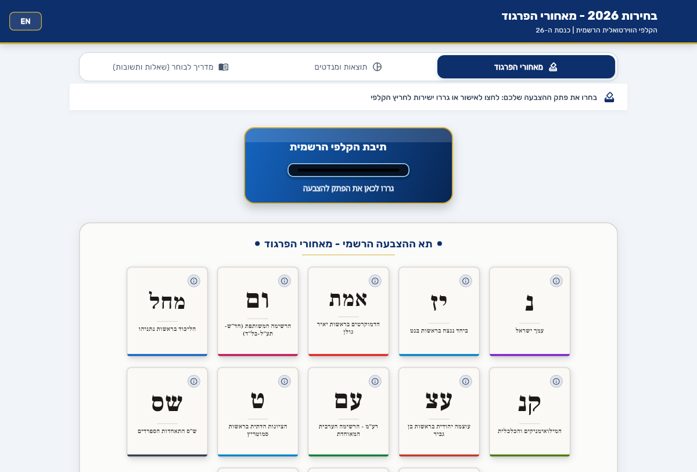
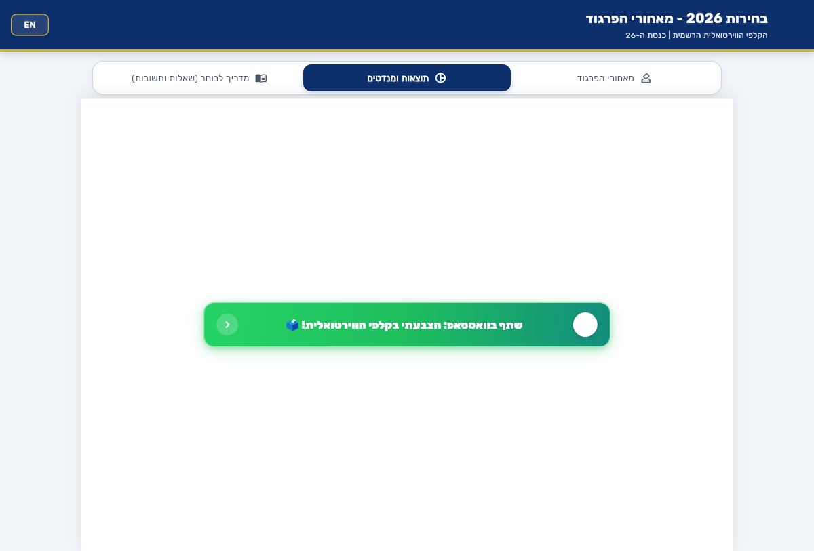

# 🗳️ בחירות 2026 | קלפי וירטואלית

[](https://bhirot2026.web.app)
[](https://flutter.dev)
[](https://firebase.google.com)
[](LICENSE)

**הקלפי הוירטואלית של הכנסת ה-26** — סימולטור בחירות ארצי אינטראקטיבי, אנונימי ומאובטח המאפשר לכל אזרח להצביע מאחורי הפרגוד, לצפות בחלוקת המנדטים בזמן אמת לפי חוק בדר-עופר, ולעיין במדריך מקיף לבוחר לקראת יום הבחירות לכנסת ה-26.

🔗 **כתובת האתר החי (Production):** [https://bhirot2026.web.app](https://bhirot2026.web.app)

---

## 📸 צילומי מסך (Screenshots)

| מאחורי הפרגוד (Voting Booth) | תוצאות האמת ומליאת הכנסת (Live Results) |
| :---: | :---: |
|  |  |

---

## ✨ תכונות מרכזיות (Key Features)

### 🗳️ תא ההצבעה מאחורי הפרגוד
- **פתקי הצבעה אותנטיים**: פתקים לבנים קלאסיים עם אותיות רשמיות של ועדת הבחירות המרכזית (CEC) בפונט פרנק-ריהל ליברה (למשל: בנט `רק`, איזנקוט `דרך`, בן גביר `ב`, סמוטריץ' ופייגלין `ט`, המילואימניקים והכלכלית `די`, הרשימה המשותפת `ודם`, עמך ישראל `ך`).
- **שתי צורות הצבעה**:
  1. **גרירה ושחרור (Drag & Drop)**: גרירת הפתק ישירות אל חריץ הקלפי הכחולה עם משוב רטט (Haptic Feedback) ואנימציית שלשול לתוך התיבה.
  2. **לחיצה ואישור (Tap to Confirm)**: דיאלוג אישור רשמי הכולל את אותיות הפתק ושם הרשימה המלא.
- **תיבת הקלפי הכחולה**: עיצוב פלסטיק ממלכתי אותנטי עם סמל מדינת ישראל הרשמי ברזולוציה גבוהה.
- **כרטיס מידע לכל רשימה**: גישה ישירה למצע המפלגה, מובילי הרשימה, שיוך גושי, רשימת המועמדים הרשמית (PDF) ועמוד המפלגה במכון הישראלי לדמוקרטיה (IDI).

### 📊 תוצאות האמת וחלוקת מנדטים
- **מליאת הכנסת (120 מושבים)**: תרשים קשת חצי-מעגלי אינטראקטיבי של 120 חברי הכנסת בצבעי המפלגות.
- **מחשבון בדר-עופר (Bader-Ofer)**: אלגוריתם חלוקת מנדטים רשמי, כולל סינון אחוז חסימה (3.25%) וחלוקת עודפי קולות.
- **מאזן הגושים**: השוואה גרפית חיה בין קואליציה לאופוזיציה ביחס לקו הרוב (61 מנדטים).
- **רשימות מתחת לאחוז החסימה**: מתחם נפרד המציג רשימות שלא עברו את הרף באחוזים ובקולות.
- **קישורים אינטראקטיביים**: "הבא בתור" (סימולטור המועמד הבא שייכנס לכנסת) ו"משחק הרכבת קואליציה".

### 📖 מדריך לבוחר ("רוצה לדעת איפה הקלפי שלך?")
- **איתור קלפי ממשלתי**: כרטיס בולט עם קישור ישיר למערכת איתור הקלפיות הרשמית של משרד הפנים: [gov.il/apps/moin/bocharim](https://www.gov.il/apps/moin/bocharim/).
- **17 שאלות ותשובות מקיפות**: כיסוי מלא של נהלי הצבעה, זיהוי (ללא צורך בהודעה לבוחר), מעטפות כפולות, שעות פתיחה, פתקים לבנים, עובדים ביום הבחירות ועוד.

### 🔒 אבטחה, חשאיות והצבעה אחת
- **עקרון הבחירות החשאיות**: פתק ההצבעה נרשם ללא שמירת זהות הבוחר — אין חיבור בין מזהה המכשיר לבין המפלגה שנבחרה.
- **מניעת הצבעה כפולה (One Vote Enforcement)**: שילוב מזהה אנונימי מקומי (Device Fingerprint) יחד עם כללי אבטחה מחמירים ב-Firebase Realtime Database (`".write": "!data.exists()"`).
- **אינטראקטיביות לאחר הצבעה**: משתמש שהצביע יכול להמשיך לגרור פתקים, אך פעולת השלשול נחסמת ומוקפצת הודעת טוסט מסבירה עם קישור ישיר לתוצאות.

### ⚙️ פאנל ניהול מפתחים (`/admin`)
- **חסום לחלוטין בפרודקשן (403 Forbidden)**: נגיש אך ורק בסביבת Localhost (`localhost:8080/admin`).
- **מעקב בזמן אמת**: פילוח מדויק של קולות אמת לעומת קולות סימולציה/סיד.
- **הזרקת קולות בבאצ'ים (Batch Injection)**: כלי בדיקות ייעודי עם סימון קולות סימולציה.
- **איפוס מקומי מהיר**: כפתור איפוס סטטוס המכשיר לבדיקות חוזרות.

---

## 🛠️ טכנולוגיות וארכיטקטורה (Tech Stack)

| שכבה | טכנולוגיה |
| :--- | :--- |
| **Frontend Framework** | [Flutter](https://flutter.dev) (Web & Mobile, Dart 3) |
| **Database** | [Firebase Realtime Database](https://firebase.google.com/docs/database) (Atomic Increments & WebSockets) |
| **Hosting & CDN** | [Firebase Hosting](https://firebase.google.com/docs/hosting) (Global Edge Cache, HTTPS, Custom Routing) |
| **State Management** | [Provider](https://pub.dev/packages/provider) & `ChangeNotifier` |
| **Typography & Fonts** | Google Fonts: **Rubik** (ממשק) & **Frank Ruhl Libre** (פתקי קלפי מסורתיים) |
| **Testing** | Flutter Test (Unit, Widget & Integration Tests) |

---

## 🚀 התקנה והרצה מקומית (Getting Started)

### דרישות קדם (Prerequisites)
- [Flutter SDK](https://docs.flutter.dev/get-started/install) (גירסה 3.24 ואילך)
- [Firebase CLI](https://firebase.google.com/docs/cli) (`npm install -g firebase-tools`)
- דפדפן Google Chrome

### שלבי התקנה (Setup Steps)

1. **שכפול המאגר:**
   ```bash
   git clone https://github.com/unix14/behirot2026.git
   cd behirot2026
   ```

2. **התקנת תלויות:**
   ```bash
   flutter pub get
   ```

3. **הרצת בדיקות אוטומטיות:**
   ```bash
   flutter test
   ```

4. **הרצה בסביבת פיתוח (Web):**
   ```bash
   flutter run -d chrome
   ```
   או הרצת שרת Firebase Hosting מקומי:
   ```bash
   firebase serve --only hosting --port 8080
   ```

5. **גישה לפאנל הניהול:**
   בסביבת localhost בלבד, גלשו לכתובת:
   ```
   http://localhost:8080/admin
   ```

---

## 📦 בנייה ופריסה (Build & Deploy)

```bash
# בניית גירסת Web Release ממוטבת
flutter build web --release

# פריסה ישירה ל-Firebase Hosting
firebase deploy --only hosting
```

---

## ⚖️ הצהרה משפטית וזכויות (Disclaimer)

פרויקט זה הינו מיזם אזרחי-חינוכי פתוח, סקר דעת קהל וסימולטור בחירות עצמאי. האתר אינו מקושר רשמית לממשלת ישראל או לוועדת הבחירות המרכזית, ואינו מחליף הצבעה פיזית בקלפי ביום הבחירות הרשמי.

כלל הלוגואים ושמות המפלגות הינם קניינם של הגופים הרשמיים, והשימוש בהם נעשה במסגרת שימוש הוגן לצורכי יידוע הציבור, סימולציה וחינוך אזרחי.

---

**נוצר באהבה לדמוקרטיה הישראלית 🇮🇱**
